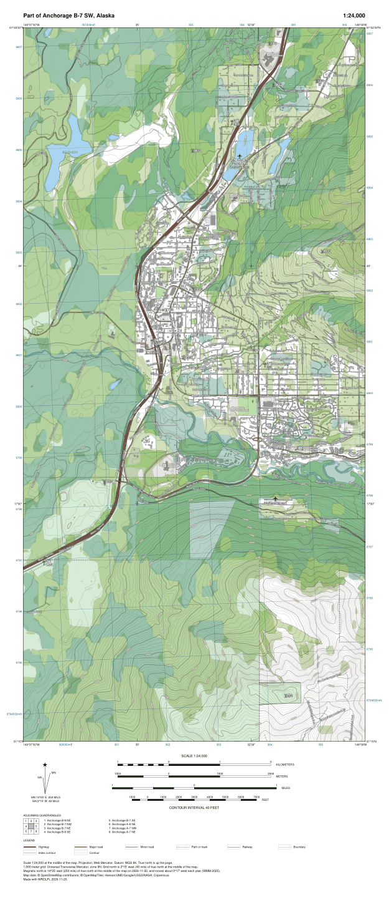
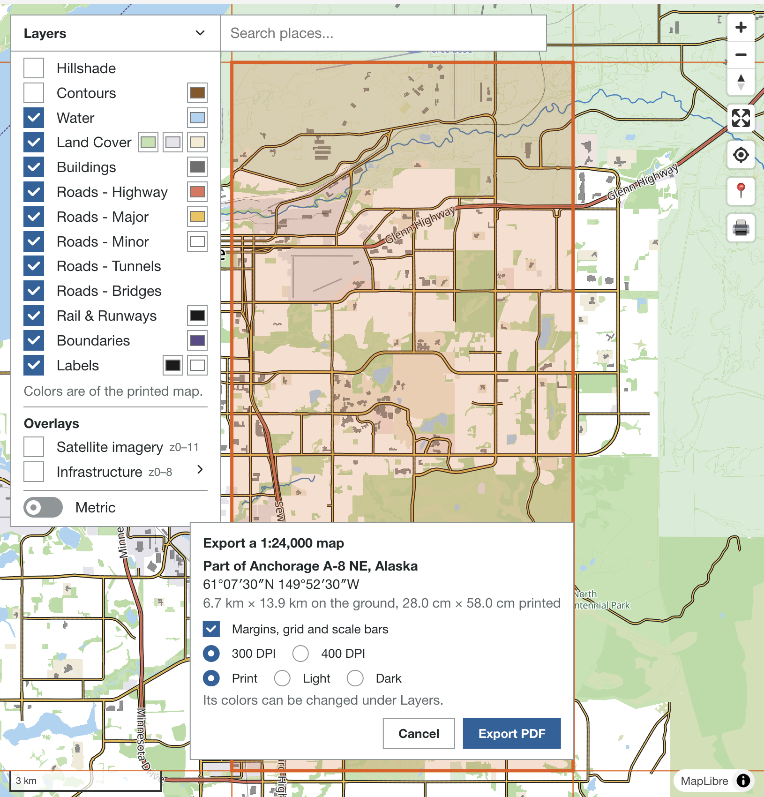
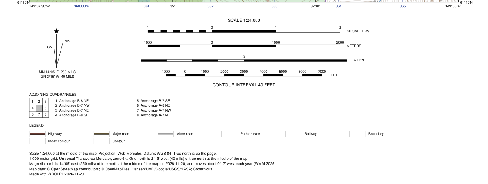

# Exporting a Map as a PDF

WROLPi can make a PDF of your map to print or to carry on a phone: one 7.5-minute quadrangle at
1:24,000, the size and scale of a USGS topographic sheet. The PDF is made on your WROLPi from the
map files you already have, so it works without the Internet.

## Making a PDF

> To export a map, click the printer button at the top-right of the map, click the quadrangle you
> want, and click **Export PDF**.

1. Click the **printer** button. A grid of quadrangles is drawn over the map. If you see
   "Zoom in to see the quadrangles", zoom in until the grid appears.
2. Click a quadrangle. The picker shows its name, its southwest corner, and how large it is on the
   ground and on paper.
3. Choose your options (below) and click **Export PDF**.
4. WROLPi draws the map, sends it to your WROLPi, and builds the PDF. When it is done your browser
   saves the file, named for the quadrangle (e.g. `wrolpi-map_24k_Berthoud_N40.250_W105.125.pdf`).

**Cancel** stops an export at any point. Leaving the map page stops it too.

The PDF shows **what is turned on in the Layer Control**: turn off Buildings and they are not in the
PDF; turn on Contours, Hillshade or an [overlay](overlays.md) and they are.

| Option | What it does |
|--------|--------------|
| **Margins, grid and scale bars** | Puts the map on a sheet (see [What Is on the Sheet](#what-is-on-the-sheet)). Uncheck it to export the map alone, edge to edge. |
| **300 DPI** / **400 DPI** | How sharp the map is. 300 is sharp on paper. 400 is sharper, takes longer, and makes a larger file. |
| **Print** / **Light** / **Dark** | The colors of the map. **Print** is made for paper. **Light** and **Dark** are the maps you see on a screen, for a PDF you will only read on one. |

> While the picker is open the map on your screen is shown in the colors you chose, so what you see
> is what you will get. It goes back to your theme when you close the picker.

Making a PDF takes a minute or two on a Raspberry Pi 4 at 300 DPI, and about three minutes at
400 DPI. The status under the options says how far along it is. If the map can not be made as sharp
as you asked (a browser limits how large a map it will draw), the status says what it is being
drawn at, e.g. "at 330 DPI".

## Print Colors

The maps you see on a screen are made to be lit from behind: pale roads on a pale ground. On paper
they are nearly invisible. The **Print** colors are made for paper: a white ground, roads with dark
edges, dark names, blue streams wide enough to see, and paths and tracks drawn as broken lines.

You can choose the colors yourself. While the picker is open and **Print** is chosen, open the
**Layer Control**: each layer has its color beside it.

> To change a color of the printed map, click the color beside a layer in the Layer Control and
> pick another. The map changes as you choose.

- Most layers have one color. **Land Cover** has three (parks and woods; schools, hospitals and
  industry; sand and ice) and **Labels** has two (the name, and the halo around it).
- Streams, rivers and the names of water are drawn in a darker shade of the color you choose for
  **Water**, so a thin line can still be seen.
- The dark edge of a road is not chosen; it is what makes a road a line on paper.
- **Reset colors**, under the layers, puts the colors back. It is shown once you have changed one.

Your colors, and whether you last exported in Print, Light or Dark, are saved in your browser, so
each browser and device remembers its own.

> An overlay with a [style](overlays.md#overlay-styles) of its own keeps its own colors, which were made for a
> screen. Check how it looks in the Print colors before you print.

## What Is on the Sheet

| Part | What it shows |
|------|---------------|
| **Title** | What the USGS calls the quadrangle, and the scale. Outside the United States, where there is no such name, the title is the coordinates of the southwest corner. |
| **Corners and ticks** | The latitude and longitude of each corner, and ticks every 2.5 minutes between them. |
| **UTM grid** | A 1,000 meter grid in blue, with its eastings and northings in the margin. The grid is not drawn north of 84° or south of 80°, where there are no UTM zones. |
| **Scale bars** | Kilometers, meters, miles and feet. |
| **Norths** | A diagram of true north (the star), grid north (GN) and magnetic north (MN), each with its angle in degrees and in mils. |
| **Contour interval** | How far apart the contour lines are, when Contours are on. It is in feet or meters, whichever the scale bar of your map is set to. |
| **Adjoining quadrangles** | The names of the eight quadrangles around this one (United States only). |
| **Legend** | The lines of the map as they are drawn on this sheet: roads, paths, railways, boundaries and contours. |
| **Notes** | The scale, projection and datum, the grid zone, magnetic declination and the date it is for, where the map data is from, and the day the sheet was made. |

A few things to know:

- **Scale.** The sheet is 1:24,000 at the middle of the map. The map is drawn in the Web Mercator
  projection, like the map on your screen.
- **Magnetic north** is calculated for the day you export, from the World Magnetic Model
  (WMM2025), which is good from 2025 through 2029. A sheet made after that does not show magnetic
  north. Magnetic north moves; the note says how much each year.
- **Alaska.** USGS quadrangles in Alaska are wider than 7.5 minutes, so a sheet there is named
  "Part of ..." the quadrangle it is in.
- **Paper.** A sheet is larger than office paper: about 19 by 29 inches (48 by 73 cm) at 40°
  north, and narrower further north (12.5 by 29 inches at 61°). Print it on a large-format printer, or use your PDF
  reader's "poster" or "tile" printing to print it across several pages at 100% scale.

## Layers in the PDF

Each layer of the Layer Control, and each overlay, is a layer of the PDF, as are the **UTM grid** and
the **Sheet** (the margin). A PDF reader which shows layers (Adobe Acrobat, for one) can turn each
on and off: print the same file with or without buildings, contours or the grid.

## Using the PDF With GPS

The PDF is georeferenced: it says where on the Earth it is. An app which reads georeferenced PDFs
can show your position on it, or lay it over its own map.

| App | Result |
|-----|--------|
| **Adobe Acrobat** (desktop) | Works. **All tools > Measure > Geospatial Location Tool** shows the latitude and longitude under the pointer; right-click the map for **Mark Location**. |
| **iTAK** (iPhone) | Works. The imported PDF is laid over the app's map in the right place. |
| **GDAL** | Works (`gdalinfo` reports the corners of the sheet). |

A place on the sheet is where the PDF says it is to within a few centimeters. How well your phone
knows where *it* is is a much larger error than that.

## Limits

- One scale (1:24,000) and one quadrangle a PDF.
- The names of roads, places and water are part of the picture: they can not be searched or
  selected in the PDF.
- Streams are not drawn north of about 65°, where the map files do not have them at this scale.
- The [Standalone Map Viewer](index.md#standalone-map-viewer) can not export.
