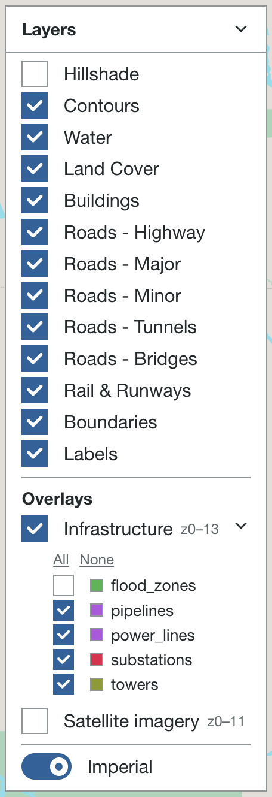

# Map

The Map module displays offline vector maps using MapLibre GL JS and PMTiles files. Maps are rendered
in the browser using your device's GPU, providing fast and smooth navigation with layer control.

The module is powered by [Protomaps](https://protomaps.com/) — an open-source system for
self-hosting vector maps from a single PMTiles file.

## Map Tab

The Map tab displays an interactive map with the following controls:

- **Layer Control** (top-left) — Toggle visibility of map layers: roads, water, buildings,
  land cover, boundaries, labels, hillshade, contours, and more. Your choices are saved
  between sessions. [Overlays](#overlays) are listed here too.
- **GPS Location** (top-right) — Request your device's GPS position and center the map on it.
- **Zoom & Navigation** (top-right) — Zoom in/out, rotate, and tilt the map.
- **Fullscreen** (top-right) — Expand the map to fill the entire screen.
- **Scale Bar** (bottom-left) — Distance scale. Click to toggle between metric and imperial.
- **Dark/Light Mode** — The map automatically matches your WROLPi theme.

### Context Menu

Right-click (or long-press on mobile) anywhere on the map to open the context menu:

- **Copy Coordinates** — Copy the latitude and longitude to your clipboard.
- **Export PNG** — Save a screenshot of the current map view as a PNG file.
  The filename includes the GPS coordinates of the center of the map.
- **Add Pin** — Place a named pin at that location.

### Sharing Coordinates

The URL updates as you navigate the map, encoding the current position and zoom level:

```
https://your-wrolpi/map?lat=45.5231&lon=-122.6765&z=12
```

Share this URL to link someone directly to a specific location and zoom level.

### Search

Type in the search box at the top center of the map to find places by name.

- **Place search** — Type a city, town, park, or region name. Results appear in a dropdown
  showing the place name, administrative region (e.g., "Oregon"), and population.
- **Coordinate search** — Type coordinates like `45.5, -122.6` to navigate directly to
  that location.
- **Proximity bias** — Results are sorted by proximity to your current map view, so nearby
  places appear first.
- **Prefix matching** — Typing partial names works (e.g., "Port" finds "Portland").
- **Fuzzy fallback** — If no exact match is found, a broader substring search is attempted.

Click a result to fly to that location with a marker and popup. Press Escape to close the
dropdown.

> Search data is extracted from the same PMTiles map files you already have. No additional
> downloads are needed. When search indexes include Wikidata enrichment, results show
> administrative regions (state/province) to help distinguish places with the same name.

## Pins Tab

Map pins let you mark and name important locations. Pins are stored in `map_pins.yaml`
in your media directory and persist across restarts.

### Adding Pins

- Right-click (or long-press on mobile) on the map and select **Add Pin**
- Enter a name and optional description

### Managing Pins

The Pins tab shows a table of all your pins with:

- **Filter** — Type to search pins by name
- **Navigate** — Click the location icon to fly the map to that pin
- **Edit** — Change the pin's name or description
- **Delete** — Remove the pin

## Manage Tab

The Manage tab has two sections:

### Map Files

Lists every `.pmtiles` file in the map directory of your media directory (`map/`), including
files in sub-directories. A file in a sub-directory is shown with its directory
(e.g. `extras/infrastructure.pmtiles`). Files can be deleted from here.

| Column      | What it shows |
|-------------|---------------|
| **File**    | The file's path within the map directory, and the name the file gives itself (when it has one). |
| **Type**    | How the map draws the file: **Basemap**, **Overlay**, **Overlay (styled)**, **Terrain**, or **Unreadable**. See [Special File Names](#special-file-names) and [Overlays](#overlays). |
| **Size**    | The size of the file. |
| **Search**  | Whether a search index exists (basemap files only). |
| **Visible** | Whether the map uses the file. |

#### Visible

Turn off a file's **Visible** toggle to make the map ignore it without deleting it. An ignored file is
not drawn, is not offered in the Layer Control, and its places are not found by search. It stays
in this list so you can turn it back on.

> Ignoring a full planet file makes the map use your regional files again, exactly as if the planet
> file were not there.

The files you ignore are saved in `maps.yaml` (see [How Configs Work](../../system/configs.md)) as their
paths within the map directory. Deleting a file also removes it from `maps.yaml`.

```yaml
ignored_files:
- extras/satellite.pmtiles
```

#### Search

The **Search** column shows whether a search index exists for each basemap file. Overlays and
terrain files have no search index:

- **Built** (green) — A search index exists. Place search is available for this file.
- **Build** (button) — No search index yet. Click to generate one using `tippecanoe-decode`.
  If WROL Mode is not active, the index will also be enriched with region names from Wikidata.

> Search indexes are small SQLite databases (typically 1-4 MB per region) stored alongside
> the PMTiles file with a `.search.db` extension. They are created automatically when you
> download a region via subscriptions, or you can build them manually with the Build button.

### Map Subscriptions

Subscribe to map regions to download them automatically from the WROLPi CDN.

- Browse the catalog of available regions (33 regions covering the entire world, plus terrain)
- Click **Subscribe** to add a region
- Click **View** to preview a region's coverage area on a mini map
- Click **View All Regions** to see all available regions on a world map
- Click **Unsubscribe** to remove a region

Subscribed regions are downloaded via aria2c and automatically renewed every 180 days
to keep your maps up to date.

## Map Subscriptions

When you subscribe to a region:

1. WROLPi fetches the map manifest from the CDN and verifies its GPG signature
2. A download is created for each subscribed region
3. aria2c downloads the pre-extracted PMTiles file from the CDN
4. After download, the meta4 file's GPG-signed hash is verified to ensure the file
   is authentic and untampered
5. The file is placed in your map directory with a versioned filename
   (e.g., `us-west-20260329.pmtiles`)
6. A pre-built search index (`.search.db`) is downloaded from the CDN, also with
   GPG-signed hash verification. This provides instant place search with region names.

> Downloads are integrity-verified at multiple levels: the manifest is GPG-signed,
> each file's SHA-256 hash is GPG-signed in its meta4 file, and aria2c verifies
> the hash during download.

## Special File Names

WROLPi reads each PMTiles file to decide how the map draws it. A file is a **basemap** when it
contains the Protomaps layers (`earth`, `water` and `roads`). Any other readable file is an
[overlay](#overlays). A file which is not a PMTiles file is listed as **Unreadable** and is never drawn.

Some file names are also handled specially:

| Pattern                       | Behavior |
|-------------------------------|----------|
| `planet-*.pmtiles`            | A basemap with this name is a full planet file — used as the sole basemap. Regional extracts and the planet overview are skipped. Overlays and terrain are still drawn. |
| `YYYYMMDD.pmtiles` (8 digits) | Also treated as a full planet file. This is the naming convention used by [Protomaps builds](https://maps.protomaps.com/builds/). |
| `map-overview.pmtiles`        | Low-zoom base layer (zoom 0-6). Provides a global overview when using regional extracts. Not treated as a full planet. |
| `terrain-*.pmtiles`           | Terrain DEM data for hillshade and contour layers. Not loaded as a vector source. |
| Any other basemap             | Regional vector tiles. Multiple regional files render together on the map. |
| Any other file                | An [overlay](#overlays). |

> Map files can be organized in sub-directories of the map directory. Hidden directories (names
> starting with `.`) are skipped; WROLPi keeps unfinished downloads in one.

## Getting Map Files

### Via Subscriptions (Recommended)

The easiest way to get map files is through **Map Subscriptions** on the Manage tab. WROLPi
hosts pre-extracted regions on a CDN that are downloaded automatically.

### Full Planet File

For complete global coverage, download the full planet file directly from
[Protomaps](https://maps.protomaps.com/builds/) and place it in your map directory.
The planet file is approximately 100-135 GB.

> WROLPi does not host the planet file due to its size. Download it directly from Protomaps.

### Custom Regions with pmtiles CLI

Use the `pmtiles` command-line tool to extract a custom region:

```shell
# Extract a single state (Oregon)
pmtiles extract https://build.protomaps.com/YYYYMMDD.pmtiles /media/wrolpi/map/oregon.pmtiles \
  --bbox="-124.8,42.0,-116.5,46.3"
```

Replace `YYYYMMDD` with the latest build date from the
[Protomaps builds page](https://maps.protomaps.com/builds/).

The `pmtiles extract` command uses HTTP Range Requests to download only the tiles for your
selected region, so you do not need to download the entire planet file.

### Multiple Regions

You can load multiple PMTiles files at once. For example, download separate files for the
contiguous US, Alaska, and Hawaii, and they will all render together on the map.

## Terrain

The map supports hillshade and contour overlays when a terrain file is available.

### Downloading

You can download map terrain files from [Mapterhorn](https://mapterhorn.com/data-access/)

### Setup

Place a terrain PMTiles file (DEM data in Terrarium encoding) in your map directory.
The file name must start with `terrain-` (e.g., `terrain-z0-8.pmtiles`).

You can subscribe to the **Terrain** region on the Manage tab to download the terrain file
automatically.

### Using Terrain Layers

Once a terrain file is detected, two additional layer groups appear in the Layer Control:

- **Hillshade** — Shaded relief showing elevation changes. Hidden by default.
- **Contours** — Elevation contour lines with labels. Hidden by default. Labels show
  elevation in meters or feet depending on the scale bar setting (click the scale bar to toggle).

> Terrain layers are hidden by default to keep the map clean. Enable them in the Layer Control
> when you need elevation information.

## Overlays

An overlay is any PMTiles file in your map directory that is not a basemap or a terrain file: power
lines, towers, trails, flood zones, satellite imagery, or anything else you have as vector or raster
tiles. Overlays are drawn on top of the basemap.

To add an overlay, put the `.pmtiles` file in the map directory (or a sub-directory of it). No restart
is needed; reload the map.

### Showing an Overlay

Overlays are listed in the **Overlays** section of the Layer Control, under the basemap layers. Each
overlay is named by the name stored inside the file, or by its file name when it has none.



> To show an overlay, open the Layer Control and check the overlay's box. A new overlay is hidden until
> you check it.

- A **vector** overlay has an arrow beside it. Click the arrow to list the layers inside the file, each
  with its own checkbox, and **All** / **None** to check or clear them together.
- A layer of something the basemap already draws (roads, water, buildings, place names, and so on)
  starts unchecked, so the map is not drawn twice. Check the layer if you want the overlay's version
  of it.
- A **raster** overlay (imagery) is a single layer. It is drawn beneath the basemap's labels so place
  names stay readable.
- The zoom levels the file has tiles for are shown beside its name (e.g. `z0–13`).
- Click a feature of a vector overlay to see its attributes.

Your choices are saved in your browser, so each browser and device remembers its own.

> An overlay which you never want to see can be ignored entirely with its **Visible** toggle on the
> [Manage tab](#visible).

### How an Overlay Is Drawn

A PMTiles file contains shapes and their attributes, but not how they should look. Without a
[style](#overlay-styles), WROLPi draws each layer of a vector overlay in its own color — areas as
translucent fills, lines as lines, and points as dots — and shows that color beside the layer's
checkbox.

### Overlay Styles

To control how an overlay looks, put a [MapLibre style](https://maplibre.org/maplibre-style-spec/)
beside the file. The Manage tab then lists the file as **Overlay (styled)**.

| Style file                 | Applies to |
|----------------------------|------------|
| `<name>.style.json`        | The file `<name>.pmtiles` in the same directory. |
| `style.json`               | Every `.pmtiles` file in the same directory which has no style of its own. |

For example, `map/extras/style.json` styles both `map/extras/roads.pmtiles` and
`map/extras/towers.pmtiles`.

The style can be one written for another map. WROLPi uses only what is safe and meaningful offline:

- **Only the layers which draw that file are used.** The style's background, and layers which draw
  other data (hillshade, contours, another tile set), are left out.
- **Nothing is fetched from another address.** The tile, icon and font addresses in the style are
  never used.
- **Fonts** are replaced with the fonts WROLPi has (Noto Sans regular, medium and italic).
- **Icons** are replaced with [WROLPi's icons](#overlay-icons).
- **Patterns** (textured fills such as marsh or sand) are drawn as a translucent color.
- A layer the map cannot draw is skipped, and the Layer Control says how many were skipped. The rest
  of the overlay is still drawn.

A styled overlay lists only the layers its style draws.

Two optional settings can be added to the style's `metadata`:

| Setting           | What it does |
|-------------------|--------------|
| `wrolpi:minzoom`  | The overlay is only drawn from this zoom level in. Use this for a style designed for one scale (a printed map, for example), which is unreadable when zoomed out. |
| `wrolpi:source`   | The name of the style's source which is this file. Only needed when WROLPi picks the wrong one; it normally picks the source most of the matching layers use. |

```json
{
  "version": 8,
  "metadata": {"wrolpi:minzoom": 11},
  "sources": {"features": {"type": "vector", "url": "..."}},
  "layers": [
    {
      "id": "towers",
      "type": "symbol",
      "source": "features",
      "source-layer": "towers",
      "layout": {"icon-image": "tower", "text-field": ["get", "name"]}
    }
  ]
}
```

> A style written for a whole map paints its own land, water and roads, so it covers the basemap
> beneath it. Uncheck the layers you do not want, or the basemap layers they duplicate.

### Overlay Icons

WROLPi comes with over 700 map icons (the [Maki](https://github.com/mapbox/maki) and
[Temaki](https://github.com/rapideditor/temaki) sets, both in the public domain) and draws these
wherever an overlay's style asks for an icon. The icons a style was originally made for are not
needed and are not used; a sprite sheet beside the file is ignored.

An icon is matched by the name the style uses for it:

- The icon's own name, with underscores or hyphens: `fire_station` and `fire-station` are the same icon.
- Other common names for it: `ham_radio` and `repeater` are the antenna, `post_office` is the post
  icon, `campground` is the campsite, and so on.
- A name WROLPi has no icon for is drawn as a plain dot, so the feature is still marked.

Icons take the color and outline the style gives them. Without a color they are dark with a light
outline, so they can be seen on both the light and dark maps. A style's icon size is ignored; WROLPi's
icons are all drawn at one size.

### Standalone Map Viewer

WROLPi also serves the map by itself on port `:8084` (`https://your-wrolpi:8084`), which keeps working
when the main app is unavailable. It shows the same overlays, styles and icons, in the same
**Overlays** section of its layer panel. Its choices are remembered separately from the main map's.

## Global Search

Map places also appear in WROLPi's global search. When you search from the navigation bar:

- The **Map** tab shows the number of matching map places alongside Files, Zims, and Other
- Clicking the Map tab displays results as cards with mini map previews showing each location
- Click a card to navigate to that location on the map page
- Results are paginated (12 per page) with the same region and population information
