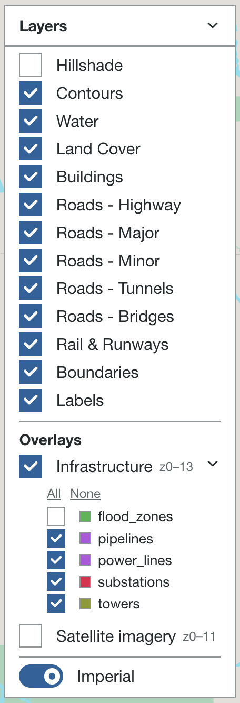

# Overlays

An overlay is any PMTiles file in your map directory that is not a basemap or a terrain file: power
lines, towers, trails, flood zones, satellite imagery, or anything else you have as vector or raster
tiles. Overlays are drawn on top of the basemap.

To add an overlay, put the `.pmtiles` file in the map directory (or a sub-directory of it). No restart
is needed; reload the map.

## Showing an Overlay

Overlays are listed in the **Overlays** section of the Layer Control, under the basemap layers. Each
overlay is named by the name stored inside the file, or by its file name when it has none.



> To show an overlay, open the Layer Control and check the overlay's box. A new overlay is hidden until
> you check it.

- A **vector** overlay has an arrow beside it. Click the arrow to list the layers inside the file, each
  with its own checkbox, and **All** / **None** to check or clear them together.
- A layer of something the basemap already draws (roads, water, buildings, place names, and so on)
  starts unchecked, so the map is not drawn twice. Check the layer if you want the overlay's version
  of it.
- A **raster** overlay (imagery) is a single layer. It is drawn beneath the basemap's labels so place
  names stay readable.
- The zoom levels the file has tiles for are shown beside its name (e.g. `z0–13`).
- Click a feature of a vector overlay to see its attributes.

Your choices are saved in your browser, so each browser and device remembers its own.

> An overlay which you never want to see can be ignored entirely with its **Visible** toggle on the
> [Manage tab](files.md#visible).

## How an Overlay Is Drawn

A PMTiles file contains shapes and their attributes, but not how they should look. Without a
[style](#overlay-styles), WROLPi draws each layer of a vector overlay in its own color — areas as
translucent fills, lines as lines, and points as dots — and shows that color beside the layer's
checkbox.

## Overlay Styles

To control how an overlay looks, put a [MapLibre style](https://maplibre.org/maplibre-style-spec/)
beside the file. The Manage tab then lists the file as **Overlay (styled)**.

| Style file                 | Applies to |
|----------------------------|------------|
| `<name>.style.json`        | The file `<name>.pmtiles` in the same directory. |
| `style.json`               | Every `.pmtiles` file in the same directory which has no style of its own. |

For example, `map/extras/style.json` styles both `map/extras/roads.pmtiles` and
`map/extras/towers.pmtiles`.

The style can be one written for another map. WROLPi uses only what is safe and meaningful offline:

- **Only the layers which draw that file are used.** The style's background, and layers which draw
  other data (hillshade, contours, another tile set), are left out.
- **Nothing is fetched from another address.** The tile, icon and font addresses in the style are
  never used.
- **Fonts** are replaced with the fonts WROLPi has (Noto Sans regular, medium and italic).
- **Icons** are replaced with [WROLPi's icons](#overlay-icons).
- **Patterns** (textured fills such as marsh or sand) are drawn as a translucent color.
- A layer the map cannot draw is skipped, and the Layer Control says how many were skipped. The rest
  of the overlay is still drawn.

A styled overlay lists only the layers its style draws.

Two optional settings can be added to the style's `metadata`:

| Setting           | What it does |
|-------------------|--------------|
| `wrolpi:minzoom`  | The overlay is only drawn from this zoom level in. Use this for a style designed for one scale (a printed map, for example), which is unreadable when zoomed out. |
| `wrolpi:source`   | The name of the style's source which is this file. Only needed when WROLPi picks the wrong one; it normally picks the source most of the matching layers use. |

```json
{
  "version": 8,
  "metadata": {"wrolpi:minzoom": 11},
  "sources": {"features": {"type": "vector", "url": "..."}},
  "layers": [
    {
      "id": "towers",
      "type": "symbol",
      "source": "features",
      "source-layer": "towers",
      "layout": {"icon-image": "tower", "text-field": ["get", "name"]}
    }
  ]
}
```

> A style written for a whole map paints its own land, water and roads, so it covers the basemap
> beneath it. Uncheck the layers you do not want, or the basemap layers they duplicate.

## Overlay Icons

WROLPi comes with over 700 map icons (the [Maki](https://github.com/mapbox/maki) and
[Temaki](https://github.com/rapideditor/temaki) sets, both in the public domain) and draws these
wherever an overlay's style asks for an icon. The icons a style was originally made for are not
needed and are not used; a sprite sheet beside the file is ignored.

An icon is matched by the name the style uses for it:

- The icon's own name, with underscores or hyphens: `fire_station` and `fire-station` are the same icon.
- Other common names for it: `ham_radio` and `repeater` are the antenna, `post_office` is the post
  icon, `campground` is the campsite, and so on.
- A name WROLPi has no icon for is drawn as a plain dot, so the feature is still marked.

Icons take the color and outline the style gives them. Without a color they are dark with a light
outline, so they can be seen on both the light and dark maps. A style's icon size is ignored; WROLPi's
icons are all drawn at one size.
